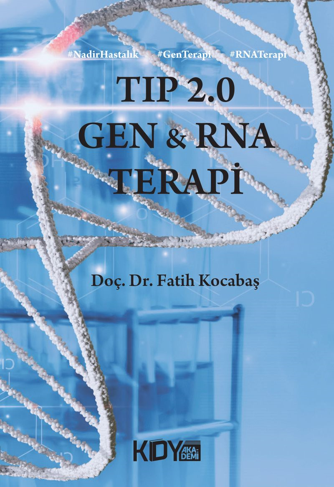

    

        <!-- Kitap görseli: assets/img/ klasörüne koyduğunuz görselin adını src kısmına yazın -->
        

            
            
Prof. Dr. Fatih Kocabaş

        

    

    
    

        <h2 class="font-weight-bold">Tıp 2.0: Gen ve RNA Terapi</h2>
        
<em>Yayın Tarihi: Haziran 2023 | Kitapyurdu Doğrudan Yayıncılık (KDY)</em>

        
        

            Sıradan bir tıp kitabından çok daha fazlası! Bu eser, hastalıkların semptomlarını tedavi etmekle yetinen geleneksel tıp anlayışının ötesine geçerek, çağdaş tıp dünyasının en önemli genetik keşiflerini ve tedavi yöntemlerini gözler önüne seriyor.
        

        

            Genetik mühendislik çalışmalarıyla geliştirilen güvenli gen aktarım sistemleri sayesinde günümüzde kanser, akdeniz anemisi ve hemofili gibi pek çok genetik hastalık tedavi edilebilir hale gelmiştir. Prof. Dr. Fatih Kocabaş, kapsamlı araştırmalarının ve geniş uzmanlık alanının ışığında; CRISPR teknolojilerini, RNA tabanlı tedavileri, öncü biyoteknoloji firmalarını ve geleceğin tıbbını sade ve akıcı bir dille okuyucuya aktarmaktadır.
        

        

        <h4>Book Details / Künye</h4>
        <ul class="list-unstyled">
            <li><strong>Author:</strong> Prof. Dr. Fatih Kocabaş</li>
            <li><strong>Publisher:</strong> KDY (Kitapyurdu Doğrudan Yayıncılık)</li>
            <li><strong>Publication Date:</strong> June 02, 2023</li>
            <li><strong>ISBN:</strong> 9786057269850</li>
            <li><strong>Format & Pages:</strong> Paperback, 238 Pages</li>
        </ul>

        

            <a href="http://genterapi.com.tr/" target="_blank" class="btn btn-primary mr-2 mb-2">
                <i class="fas fa-globe"></i> Resmi Web Sitesi (genterapi.com.tr)
            </a>
            <a href="https://www.kitapyurdu.com/kitap/tip-20-gen-ve-rna-terapi/650996.html" target="_blank" class="btn btn-outline-secondary mb-2">
                <i class="fas fa-shopping-cart"></i> Kitapyurdu Sayfası
            </a>
        

    

